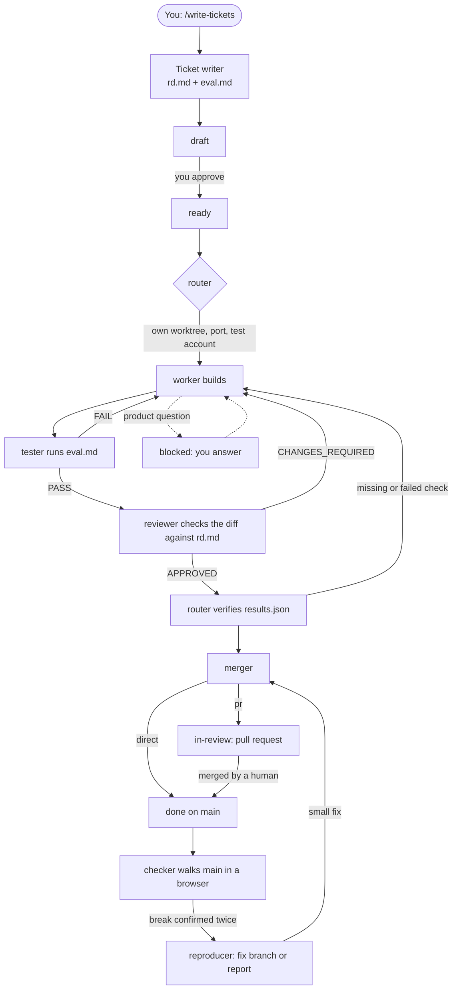

# workov

workov is a ticket workflow for coding agents. You describe a feature, a ticket writer turns it into a specification with pass/fail checks, and after you approve it a router agent hands the ticket to a worker that builds it in its own git worktree. A tester runs the checks, a reviewer reads the diff against the requirements, a merger lands the result on `main` (or opens a pull request), and a checker walks the merged app in a real browser. You follow all of it, and step in when asked, from a dashboard called Fleet Control that also works on a phone.

It installs into an existing git repository as plain files: agent definitions, two skills, a handful of bash and Python scripts with no dependencies beyond the standard library, and one HTML page. It runs on Claude Code and OpenCode, and can hand review or implementation subtasks to the Codex CLI.

This is version 0.1, the first release.


*The Board view of Fleet Control. All screenshots in this README show the real dashboard on a demo project with invented tickets.*

## Contents

- [What it does for you](#what-it-does-for-you)
- [Requirements](#requirements)
- [Install](#install)
- [Quick start: your first merged ticket](#quick-start-your-first-merged-ticket)
- [How a ticket flows](#how-a-ticket-flows)
- [Agents and skills](#agents-and-skills)
- [Fleet Control dashboard](#fleet-control-dashboard)
- [Phone access](#phone-access)
- [Configuration](#configuration)
- [Safety limits](#safety-limits)
- [Repository layout](#repository-layout)
- [Troubleshooting](#troubleshooting)
- [Contributing](#contributing)

## What it does for you

- **Tickets instead of prompts.** Every feature is a folder, `specs/tickets/NNN-slug/`, with requirements (`rd.md`) and a verification spec (`eval.md`) whose checks are run exactly as written. Nothing is built from a ticket until you approve it.
- **Parallel work without collisions.** Each worker builds in its own git worktree, on its own dev-server port, with its own test account name. Tickets declare what they wait for, and the router dispatches only what can start.
- **Two gates before a commit.** The tester runs every check in `eval.md` and saves the evidence. The reviewer rejects a diff that misses a requirement, builds something out of scope, or touches a file the ticket lists under `Do not touch`.
- **A router that keeps going.** It keeps its state in a ledger file, adopts or reaps workers after a crash, retries a failed ticket a bounded number of times, stops a ticket that reaches its budget, and asks you only for product decisions.
- **A dashboard you can act from.** Approve drafts, set priorities, answer a blocked worker, pause or stop work, and see what each ticket has cost, from the desk or from a phone.

## Requirements

- A **git repository** to install into, with **bash** and **Python 3** available. The scripts use only the standard library.
- At least one harness: **Claude Code** (`claude`) or **OpenCode** (`opencode`). The **Codex CLI** (`codex`) is optional and used only for delegation.
- **agent-browser** for browser checks, the checker and the reproducer:

  ```bash
  npm install -g agent-browser
  ```

  Agents call it through `bash .claude/scripts/browser.sh <args>`, which picks the first working binary (`$AGENT_BROWSER_BIN`, then `agent-browser` on `PATH`, then known install locations). `bash .claude/scripts/browser.sh --resolve` prints the choice.
- Optional: **`gh`** and an `origin` remote for pull-request landing; **`cloudflared`** or **`ngrok`** to reach the dashboard from a phone; **`qrencode`** to print the phone link as a QR code in the terminal.

## Install

Clone workov anywhere, then run the installer against your repository:

```bash
git clone https://github.com/tawfekov/workov.git
bash workov/.claude/scripts/install.sh /path/to/your-repo
```

The target must be an existing git repository. The installer copies `.claude/agents/`, `.claude/skills/`, `.claude/scripts/`, `.claude/dashboard/`, `.claude/settings.json`, `.opencode/agents/`, `opencode.json` and the `.agents/skills` symlink, creates `specs/workov.config.json` and an empty `specs/tickets/BOARD.md` only if they are absent, and writes the installed version to `.claude/workov.version`.

It is safe to run again: files that are already identical are left alone and a second run prints `already up to date`. A file it would overwrite is first moved to `<your-repo>/.workov-backup/<timestamp>/`. That includes an existing `.claude/settings.json` or `opencode.json`, so merge your own settings back by hand if you had any. It refuses to write through a symlink in the target and never copies runtime state.

The installer does not edit your `.gitignore`. Add the entries it prints, because `job/` holds the dashboard access token:

```gitignore
job/
.claude/worktrees/
__pycache__/
.workov-backup/
```

`bash workov/.claude/scripts/install.sh --help` prints the usage. From inside an agent session in a workov checkout, `/setup install_into=/path/to/your-repo` runs the same installer.

## Quick start: your first merged ticket

Run these inside your repository.

**1. Configure.**

```bash
python3 .claude/scripts/apply-setup.py --tunnel local
```

This writes `specs/workov.config.json`, sets the model of every agent, generates the OpenCode agent files, and creates the dashboard access token in `job/dashboard-auth.json`. `--tunnel local` opens no tunnel (the dashboard is still reachable on your local network, behind the sign-in page: see [Dashboard access](#dashboard-access)); without it the default provider is `cloudflared`, which opens a public (token-protected) URL when the dashboard starts. For Claude Code alone, add `--preset claude-default --harness claude`. In an agent session, `/setup` asks the same questions one at a time. See [Configuration](#configuration) for every option.

**2. Write a ticket.** In Claude Code or OpenCode:

```text
/write-tickets Add an Export CSV button to the orders page
```

The skill reads your codebase, asks you questions one at a time until nothing is left to guess, and writes `specs/tickets/001-.../rd.md` and `eval.md` plus a row in `specs/tickets/BOARD.md` with status `draft`.

**3. Start the dashboard.**

```bash
bash .claude/scripts/start-dashboard.sh
```

It prints the local URL (`http://127.0.0.1:3080/` by default) and the access token masked to its last four characters. Reading the dashboard on the same machine needs no token. Acting from it does: print the token with `python3 .claude/scripts/apply-setup.py --show-token` and enter it through the access button in the page header.

**4. Approve the draft.** Open the ticket and press **Approve & mark ready**, or tell your agent "Mark ticket 001 ready on the board". A ticket stays `draft` until you do.


**5. Run the router.**

```bash
claude --agent router --name router --permission-mode auto
```

Then say: `Build all ready tickets on the board.` With OpenCode, run `opencode --agent router`. If the dashboard is not running, the router starts it (`dashboard.autoStartWithRouter`).

**6. Watch it land.** The router dispatches the ticket to a worker. The worker builds, has the tester and the reviewer check the work, writes `results.md`, `results.json` and `evidence/`, and commits on its branch. The router verifies `results.json` against `eval.md`, the merger merges the branch into `main`, keeps the merge only if your project's lint and build pass, and marks the ticket `done`. The checker then walks the merged feature on `main`.

Stop the dashboard with `bash .claude/scripts/start-dashboard.sh --stop`.

## How a ticket flows



1. **Write.** `/write-tickets` reserves a number and shows the ticket as `specifying` while it is written. The finished ticket is `draft`. It holds `rd.md` (summary, numbered functional requirements `FR-N`, out of scope, affected areas, `Do not touch`, dependencies) and `eval.md` (checks `E-N` of type `Browser`, `HTTP`, `CLI` or `Test`, each with steps and pass criteria). Every `FR-N` maps to at least one `E-N`.
2. **Approve.** You set the ticket to `ready`.
3. **Dispatch.** The router starts every `ready` ticket whose dependencies are done, `P0` before `P1` before `P2`, then in board order, up to the worker limit. A `solo` ticket goes to one worker; a `team` ticket goes to two or three teammates who first agree on a `contract.md` (file ownership and shared interfaces).
4. **Build and check.** The worker implements the ticket, starts its dev server, and spawns the tester and the reviewer, fixing what they find until every check passes and the review says `APPROVED`. It records the outcome in `results.json`.
5. **Verify and land.** The router checks that `results.json` has a passing entry and an evidence file for every `E-N`. A missing or corrupt file sends the ticket back to the same worker. The merger then lands it: a merge into `main` with lint and build, undone if either fails, or a pushed branch and a pull request in [PR landing mode](#landing-mode).
6. **After the merge.** The checker walks the merged feature and its neighbours on `main`, and after every N merges every flow in `specs/regression.md`. A break it reproduced twice goes to the reproducer, which either fixes it on a branch (small, local fixes) or reports the root cause.

When a worker meets a contradiction that needs a product choice, it stops and the ticket becomes `blocked`. The question shows on the dashboard and, if you configured [notifications](#notifications), arrives as a push. Your answer is written to `specs/tickets/NNN-slug/user-decision.md` and the router forwards it to the worker.


### Ticket statuses

`specs/tickets/BOARD.md` is the single source of truth, one table row per ticket:

```text
| # | Title | Status | Mode | Prio | Runs |
| 002 | Export orders as CSV | ready | solo | P1 | after: 001 — needs the orders API |
```

| Status | Meaning | Set by |
| --- | --- | --- |
| `specifying` | A ticket writer is writing it | `/write-tickets` |
| `draft` | Written, waiting for your approval | `/write-tickets` |
| `ready` | Approved for dispatch | you |
| `in-progress` | A worker is building it | router |
| `blocked` | Waiting for your decision | router |
| `in-review` | Pull request open, waiting for a human (PR landing) | merger |
| `done` | Landed on `main` | merger |
| `failed` | Retries used up | router |
| `budget-exceeded` | Reached its cost or turn cap | router |

`Mode` is `solo` or `team`, `Prio` is `P0`, `P1` (default) or `P2`, and `Runs` is `alongside` or `after: 003, 005 — reason`. [CONTRIBUTING.md](CONTRIBUTING.md) has the full ticket and board grammar.

## Agents and skills

Agents are Markdown files in `.claude/agents/`, mirrored for OpenCode in `.opencode/agents/` by `apply-setup.py`.

| Agent | What it does |
| --- | --- |
| `router` | The session you talk to. Reads the board, dispatches tickets, verifies results, starts the merger, checker and reproducer, and enforces retries and budgets. Never writes application code. |
| `worker` | Builds one `solo` ticket in its own worktree, runs the tester and the reviewer, writes results and evidence, commits on its branch. |
| `teammate` | One member of an agent team on a `team` ticket. Agrees on `contract.md`, then edits only the files it owns. |
| `tester` | Runs every check in `eval.md` as written and returns PASS or FAIL per check with evidence. Never fixes anything. |
| `reviewer` | Reads the diff against `rd.md`: requirements complete, nothing out of scope, no `Do not touch` file changed. Read-only. |
| `merger` | Lands a finished branch on `main` or opens a pull request, and marks the ticket `done` or `in-review`. |
| `checker` | Walks the merged feature on `main` in a browser. In full mode walks every flow in `specs/regression.md`. Reports only breaks it reproduced twice. Read-only. |
| `reproducer` | Reproduces a reported bug twice in its own worktree, then fixes it on a branch if the fix is small, or reports. |
| `watchdog` | An analyst the router calls for one anomaly it cannot classify. The routine checks are a script, not an agent. |

Skills live in `.claude/skills/` (`.agents/skills` is a symlink to the same folder for harnesses that look there):

| Skill | What it does |
| --- | --- |
| `/write-tickets` | Turns feature requests into tickets: `rd.md`, `eval.md`, a board row, and `contract.md` for team tickets. Seeds `specs/regression.md` when the repository has none. |
| `/setup` | Configures the workflow by interview or by flags (`/setup harness=both preset=hybrid-bridge max_workers=4 dashboard=on tunnel=local`), and installs it into another repository with `install_into=<path>`. |

## Fleet Control dashboard

`bash .claude/scripts/start-dashboard.sh` starts a Python server (`.claude/scripts/dashboard-server.py`) that serves one self-contained page (`.claude/dashboard/index.html`, no build step and no external assets). Everything on the page is read from files the agents write: the board, worker heartbeats (`job/status.json` in each worktree), the router ledger (`job/router-state.json`) and the harness session logs. Changes are pushed to the page over Server-Sent Events, with a 3-second poll as the fallback.

The header names the project and each project gets its own dashboard on its own port, so several repositories can run side by side. The script flags are `--port`, `--tunnel`, `--stop` and `--help`.

There are six views. The URL hash keeps the view and the open ticket (`#board`, `#ring`, `#graph`, `#telemetry`, `#ports`, `#audit`, `#ticket/005`).

### Board

The view in the screenshot at the top. A strip of stations counts the tickets per stage, and a **Needs you** list collects everything that waits for you: a worker's question, a failed or over-budget ticket, a stalled or dead worker, drafts to approve. The four columns are Plan, Queue, Building and Done. A card in Building shows its pipeline step (Build, Review, Merge), `Attempt N of M`, and what it has spent against its cap. A ticket that waits for another ticket in the same column stands indented under it. Done is grouped into Today, Yesterday and Earlier. **Dispatch now** tells the router to start the ready tickets at once, and on a wide screen with a mouse a draft can be dragged onto Queue to approve it.

Below the columns, the Agents section shows each live worker with its phase, latest note, commit, and meters for turns and estimated cost:


### Ring

The same fleet as one picture: a core with one segment per worker slot, the waiting tickets around it, and a tick on the rim for each done ticket, with the Needs you list and a count per status underneath.


### Ticket drawer

Opening a ticket shows its Requirements, Evaluation and Contract as rendered Markdown, Results as a grid of checks from `results.json`, the Evidence files, and the tail of the worker's Logs. The action bar sets the priority, pauses the ticket, re-runs the checker or stops the worker.


### Graph

Open work laid out by its `Runs` dependencies: rows by state (Stopped, In flight, Ready, Draft), columns by how many levels of open work stand ahead, with a line naming what can start now.


### Telemetry

Token use and estimated cost, read from the Claude Code session logs (`~/.claude/projects/`), the OpenCode database (`~/.local/share/opencode/opencode.db`) and the Codex session logs (`~/.codex/sessions/`), priced with the `telemetry.rates` table in the config. Every figure is an estimate. The window can be this run, today or all time.


### Ports and Audit

**Ports** shows whether the main, reproducer and worker dev-server ports are listening, and the latest watchdog report. The server runs `watchdog-check.sh --json` on startup and every `watchdog.intervalSeconds` and writes `job/watchdog-report.json`. **Audit** lists every action taken from the dashboard, successful or not, from `job/audit.jsonl`.

The same checks run by hand:

```bash
bash .claude/scripts/watchdog-check.sh                   # health report
bash .claude/scripts/watchdog-check.sh --json            # the same, as JSON
bash .claude/scripts/watchdog-check.sh --reap            # dry run: stale worker worktrees
bash .claude/scripts/watchdog-check.sh --reap --apply    # salvage evidence, then remove them
```

### Themes

The page follows the system light or dark setting. The System panel can force Auto, Dark or Light, or switch to a second style called Cyberpunk. The choice is stored in the browser.

## Phone access

Set the tunnel provider to `cloudflared` or `ngrok` (`python3 .claude/scripts/apply-setup.py --tunnel cloudflared`) and start the dashboard in a terminal. It prints the public URL and, when `qrencode` is installed, a QR code that signs the phone in. The QR code carries the access token, so never share a picture of it. The **Phone link** button in the page header copies the same link.

Below 768 px the page changes shape: the views move to a bottom bar, the header becomes a one-line status, the stage columns stack, and a ticket opens full screen with its actions pinned to the bottom.

<p>
  
  
  
</p>

A visitor who is not on the machine itself and has no token sees only a sign-in page. See [Dashboard access](#dashboard-access) for the rules.

## Configuration

`specs/workov.config.json` is the one config file. `/setup` and `python3 .claude/scripts/apply-setup.py` write it, running `apply-setup.py` again with no flags changes nothing, and you can edit it by hand. Secrets never live in it: the dashboard token is in `job/dashboard-auth.json` and notification secrets are in `job/notify-secrets.json`, both under the gitignored `job/`.

| Block | Default | Meaning |
| --- | --- | --- |
| `version` | `0.1` | Config version. `apply-setup.py` exits `3` without writing if the file is from a newer workov. |
| `harness` | `both` | `claude`, `opencode` or `both`. |
| `preset`, `models.<agent>` | `hybrid-bridge` | Model and effort of each agent, per harness. |
| `concurrency` | 4 workers; ports 3000, 3090, 3101 | `maxParallelWorkers`, `mainPort`, `reproducerPort`, `workerBasePort`. |
| `dashboard` | on, port 3080, `cloudflared` | `enabled`, `autoStartWithRouter`, `port`, `allowRemoteActions`, `tunnel.provider`. |
| `budget.defaults` | `usd: 10.0`, `turns: 300` | Per-ticket caps. |
| `landing` | `direct` | `direct` or `pr`. |
| `regression.everyNMerges` | `1` | Full regression sweep after every N merges; `0` turns it off. |
| `watchdog` | `script`, 60 s, 15 min | `mode`, `intervalSeconds`, `stallThresholdMinutes`. |
| `notifications.providers` | `[]` | Push providers. |
| `telemetry.rates` | built-in table | USD per million tokens (`in`, `out`, `cache`) by model name. |
| `project.name` | directory name | Optional name shown in the dashboard and in push titles. |
| `dispatch.autoOnApprove` | `true` | Whether an Approve wakes an idle router at once. |

`python3 .claude/scripts/apply-setup.py -h` lists every flag:

| Flag | Effect |
| --- | --- |
| `--preset NAME`, `--harness claude\|opencode\|both` | Model preset and target harness |
| `--max-workers N` | Maximum parallel workers |
| `--budget-usd FLOAT`, `--budget-turns INT` | Default per-ticket caps |
| `--landing direct\|pr` | Landing mode |
| `--dashboard on\|off`, `--port N` | Dashboard on or off, and its port |
| `--tunnel cloudflared\|ngrok\|local` | Tunnel provider |
| `--main-port N`, `--reproducer-port N`, `--worker-base-port N` | Dev-server ports |
| `--remote-actions on\|off` | Allow dashboard actions, or refuse all of them |
| `--auto-dispatch-on-approve on\|off` | Whether an Approve wakes the router by itself |
| `--watchdog-mode script\|agent`, `--watchdog-interval SECONDS` | Watchdog mode and cadence |
| `--regression-every-n-merges N` | Regression sweep cadence |
| `--worker-delegate none\|codex\|opencode` | Let workers delegate listed subtasks |
| `--notify-ntfy TOPIC` | Add or update an ntfy provider |
| `--regenerate-token`, `--show-token` | Rotate the dashboard token; print it in full |

### Presets and models

| Preset | Claude Code | OpenCode |
| --- | --- | --- |
| `hybrid-bridge` (default) | `opus` router, `sonnet` for every other agent | `openai/gpt-5` router, `anthropic/claude-sonnet-4-5` workers, `openai/o3` reviewer and reproducer, `openai/gpt-4.1` merger, `openai/gpt-4.1-mini` tester, checker and watchdog |
| `claude-default` | `opus` router, `sonnet` for every other agent | `anthropic/claude-opus-4` router, `anthropic/claude-sonnet-4-5` for every other agent |
| `deepseek-lean` | `sonnet` router, workers, reviewer and reproducer; `haiku` for the small roles | `deepseek/deepseek-chat` router and small roles, `deepseek/deepseek-reasoner` workers, reviewer and reproducer |
| `budget` | `sonnet` at medium effort for router and workers, `sonnet` at high effort for reviewer and reproducer, `haiku` for the small roles | `openai/gpt-4.1` router and reproducer, `anthropic/claude-sonnet-4-5` workers at medium effort, `openai/o3` reviewer, `openai/gpt-4.1-mini` for the small roles |
| `opencode-openai` | `opus` router, `sonnet` workers, reviewer, reproducer and merger; `haiku` tester, checker and watchdog | `openai/gpt-5` router and workers, `openai/o3` reviewer and reproducer, `openai/gpt-4.1` merger, `openai/gpt-4.1-mini` tester, checker and watchdog |

To change one agent, edit `models.<agent>` in the config and run `apply-setup.py` again. [CONTRIBUTING.md](CONTRIBUTING.md) explains how to add a preset.

### Budgets and retries

- **Budget.** Every ticket is capped at an estimated **$10.00** and **300 worker turns** by default. Change the defaults with `--budget-usd` and `--budget-turns`, or one ticket with a `## Budget` section in its `rd.md` (`- USD: 20`, `- Turns: 400`). The turn cap is a hard stop set when the worker is spawned. The cost cap is checked by the router once per cycle from the telemetry of the running dashboard, counting only spend since the ticket's first dispatch. While the dashboard is not running the cost cap is not enforced; the turn cap still is. A ticket that reaches a cap becomes `budget-exceeded` and is never retried automatically.
- **Retries.** A stalled or failed worker is dispatched again up to `maxRetries` times, **2** by default, so a ticket gets at most three attempts. Each retry receives the findings of the previous attempt. Override it per ticket with a `## Retries` section (`- maxRetries: 3`). A ticket that uses up its retries becomes `failed`.

### Concurrency and ports

| Role | Config key | Default |
| --- | --- | --- |
| Main checkout (checker) | `concurrency.mainPort` | 3000 |
| Dashboard | `dashboard.port` | 3080 |
| Reproducer | `concurrency.reproducerPort` | 3090 |
| Worker slot N | `concurrency.workerBasePort + N - 1` | 3101, 3102, ... |

Each worker slot also gets a test account name (`t001`, `t002`, ...); the checker uses `t000` and the reproducer `t090`. `concurrency.maxParallelWorkers` (default 4) is the number of slots.

Two projects on one machine need different ports. `apply-setup.py` refuses ports that clash inside one project, records each project in `~/.workov/projects.json`, and prints `WARNING: port overlap` when another registered project uses the same ports. It never changes a port by itself. `start-dashboard.sh` is the exception for the dashboard port: if another process holds it and you did not pass `--port`, it starts on the next free port and saves that to the config.

### Landing mode

- **`direct`** (default): the merger merges a verified ticket into `main`.
- **`pr`**: the merger pushes the branch and opens a GitHub pull request, the ticket waits as `in-review`, and the router polls the pull request until a human merges it. Set it for the project with `--landing pr`, or for one ticket with a `## Landing` section (`- Mode: pr`) in its `rd.md`. It needs `gh` and an `origin` remote.

### Notifications

`bash .claude/scripts/notify.sh <event> "<message>" [ticket-id] [--dry-run]` pushes a message to every provider subscribed to the event. With no provider configured it does nothing and exits `0`, and a failed delivery is logged to `job/logs/notify.log` without failing the caller. `--dry-run` prints what would be sent, with secrets masked, and makes no network call.

Three providers ship: **ntfy**, **Telegram** and **Slack**.

- **ntfy.** Pick a hard-to-guess topic, subscribe to it in the ntfy app, and register it:

  ```bash
  python3 .claude/scripts/apply-setup.py --notify-ntfy my-topic-k3x9q2
  ```

  A bare topic posts to `https://ntfy.sh/<topic>`; a target that starts with `http://` or `https://` is used as it is. On the public server the topic name is the only access control, and it is stored in the config.
- **Telegram.** Create a bot with `@BotFather`, send the bot a message, read your chat id from `https://api.telegram.org/bot<TOKEN>/getUpdates`, and add:

  ```json
  { "type": "telegram", "botToken": { "secretRef": "telegram-1" }, "chatId": "<chat id>", "events": ["needs_human", "budget_exceeded"] }
  ```

- **Slack.** Create an incoming webhook and add:

  ```json
  { "type": "slack", "webhook": { "secretRef": "slack-1" }, "events": "all" }
  ```

Entries go in `notifications.providers` in the config. A secret field (`botToken`, `webhook`, or `auth` for a protected ntfy topic) is a reference, never the value: `{"secretRef": "<id>"}` resolves from `job/notify-secrets.json`, and `{"env": "WORKOV_<NAME>"}` reads an environment variable.

```json
{ "version": 1, "secrets": { "telegram-1": "<bot token>", "slack-1": "<webhook URL>" } }
```

If you paste a secret inline, the next `apply-setup.py` run moves it into `job/notify-secrets.json` (mode `0600`) and leaves a reference behind. An unknown provider type or event name is a config error: `apply-setup.py` refuses to write and `notify.sh` exits `3`.

`events` is `"all"` or a list of:

| Event | Sent when |
| --- | --- |
| `worker_blocked` | A worker needs a decision. The message carries the question and a link that opens the ticket on the dashboard. |
| `budget_exceeded` | A ticket reached its budget cap. |
| `retries_exhausted` | A ticket used up its retries. |
| `ticket_done` | A ticket was merged. |
| `regression_confirmed` | A regression sweep confirmed a break. |
| `needs_human` | The router needs you: a decision, an escalation, or a degraded swarm to resume. |
| `watchdog_stall` | A worker's heartbeat is older than `watchdog.stallThresholdMinutes`. |

### Supported harnesses

| Harness | Role |
| --- | --- |
| **Claude Code** | Runs the router and every agent. Team tickets use agent teams, which `.claude/settings.json` switches on. The router arms `.claude/scripts/router-wake.sh` in the background, so an approval, a dashboard action or a decision wakes an idle router within seconds without a chat message and without spending tokens while it waits. |
| **OpenCode** | Runs the router (`opencode --agent router`) from the generated `.opencode/agents/` and `opencode.json`. The wake watcher is not available, so dashboard changes are picked up when you next message the router. |
| **Codex CLI** | A delegate, not a router. With `--worker-delegate codex` a worker may hand subtasks that the ticket lists under `## Delegatable subtasks` to `delegate-task.sh codex exec`, and a reviewer may ask for a second opinion with `delegate-task.sh codex review`. The worker reviews every delegated diff and the tester and reviewer gates stay the same. `--worker-delegate opencode` does the same through OpenCode. |

## Safety limits

### On the work

- A ticket is never dispatched before you approve it.
- Each worker works in its own worktree and branch, and the reviewer checks the diff against the ticket's `Do not touch` list and its scope.
- Per-ticket budget (cost and turns) and a bounded number of retries, as [above](#budgets-and-retries). The cost cap needs the dashboard running; with it off, only the turn cap applies.
- When three tickets fail in one run, the router stops dispatching and asks you whether to continue or stop.
- When workers of three or more tickets die of the same provider-wide cause within five minutes, the swarm is marked degraded and nothing is dispatched until it recovers or you resume it.
- A stale worktree is never removed before its evidence and results are copied to the main checkout, and worktrees of merged tickets are removed only when you ask.
- A merge that fails lint or build is undone. In PR mode the merger never force-pushes and never merges the pull request itself.
- The router keeps its state in `job/router-state.json`, so a crashed or restarted router adopts live workers instead of building a ticket twice.

### Dashboard access

The server listens on all network interfaces, so who may see what is decided per request:

- **Local** means a request from the machine itself (a loopback address, a `Host` of `localhost` or an IP address, and no proxy headers). Local requests may read without a token. Tunnel traffic also arrives from loopback but carries proxy headers, so it is never local. A `Host` with any other name is treated as remote, which stops DNS rebinding.
- **Everyone else**, on the LAN or through a tunnel, gets a sign-in page for `/` and `401` from every API route until they present the token.
- **Actions always need the token**, even locally, and only in a header (`Authorization: Bearer` or `X-Auth-Token`), never in a query string or from the cookie alone. An action from another origin is refused with `403`, and one that is not `application/json` with `415`. Every action is written to the audit trail. `--remote-actions off` turns dashboard actions off: every action is then refused with `403`, also on the machine itself.
- The first visit through a tunnel with `/?token=...` sets an HttpOnly `workov_session` cookie for 30 days and the page removes the token from the URL. A local visit sets no cookie.
- **Five wrong tokens lock that visitor out for 10 minutes.** The count is kept per visitor, so someone else's failures do not lock out your phone, and the machine itself is never locked out by LAN or tunnel traffic. Keep `dashboard.tunnel.provider` set to the tunnel you run, because that decides which header identifies a visitor.
- Responses never carry a secret: the dashboard token and notification secrets are masked in every JSON response and text evidence file. Evidence is served inert (images as images, everything else as plain text), and the page runs under a strict Content-Security-Policy and cannot be framed.
- The token is stored on disk only in `job/dashboard-auth.json`; a browser you signed in with also keeps it. Rotate it with `python3 .claude/scripts/apply-setup.py --regenerate-token`.

[TROUBLESHOOTING.md](TROUBLESHOOTING.md) covers token rotation, lockouts and `401`, `403` and `415` answers.

## Repository layout

```text
.
├── .claude/
│   ├── agents/                  # router, worker, teammate, tester, reviewer, merger, checker, reproducer, watchdog
│   ├── skills/
│   │   ├── setup/SKILL.md       # /setup
│   │   └── write-tickets/SKILL.md   # /write-tickets
│   ├── scripts/
│   │   ├── install.sh           # install workov into an existing repository
│   │   ├── apply-setup.py       # write the config, set agent models, generate the OpenCode files
│   │   ├── start-dashboard.sh   # start or stop the dashboard and its tunnel
│   │   ├── dashboard-server.py  # dashboard API and page server
│   │   ├── telemetry.py         # token and cost attribution
│   │   ├── watchdog-check.sh    # stall, port and worktree checks; reaping
│   │   ├── router-wake.sh       # wakes an idle router on approvals, actions and decisions
│   │   ├── notify.sh            # push notifications
│   │   ├── browser.sh           # finds a working agent-browser and names browser sessions
│   │   ├── delegate-task.sh     # hands a task to the Codex or OpenCode CLI
│   │   ├── log.sh               # bounded log files for job/logs/
│   │   └── selftest.py          # self-test suite
│   ├── dashboard/
│   │   ├── index.html           # the Fleet Control page
│   │   └── signin.html          # the sign-in page for remote visitors
│   └── settings.json            # switches on agent teams for Claude Code
├── .opencode/agents/            # generated OpenCode agent files
├── .agents/skills               # symlink to .claude/skills
├── opencode.json                # generated OpenCode project config
├── specs/
│   ├── workov.config.json       # the config
│   ├── regression.md            # flows the checker walks in full mode
│   └── tickets/
│       ├── BOARD.md             # the board
│       └── NNN-slug/            # rd.md, eval.md, contract.md (team), results.md, results.json, evidence/
├── docs/images/                 # screenshots used in this README
├── README.md, CONTRIBUTING.md, TROUBLESHOOTING.md, CHANGELOG.md
├── PRODUCT.md, DESIGN.md        # what the dashboard is for, and its design system
└── workov-guide.html            # a visual guide to the workflow, as one HTML page
```

At run time a gitignored `job/` folder appears in the main checkout: the router ledger (`router-state.json`), the dashboard token (`dashboard-auth.json`), the watchdog report, the audit trail (`audit.jsonl`), swarm health (`swarm-state.json`), dashboard action requests (`control/`) and worker logs (`logs/`). Worker worktrees live under `.claude/worktrees/`, each with its own `job/status.json` heartbeat.

The `specs/regression.md` in this repository lists the flows of workov's own dashboard. It is not installed; `/write-tickets` creates one for your project.

## Troubleshooting

[TROUBLESHOOTING.md](TROUBLESHOOTING.md) is a runbook of symptom, cause and fix. The entries most people need first:

- [Port conflicts](TROUBLESHOOTING.md#port-conflicts)
- [Stale worktrees](TROUBLESHOOTING.md#stale-worktrees)
- [The phone shows a Sign in page](TROUBLESHOOTING.md#the-phone-shows-a-sign-in-page)
- [Dashboard lockout](TROUBLESHOOTING.md#dashboard-lockout)
- [Tunnel failures](TROUBLESHOOTING.md#tunnel-failures-cloudflared--ngrok)
- [Failed tickets and retries](TROUBLESHOOTING.md#failed-tickets-and-retries)
- [Budget-exceeded recovery](TROUBLESHOOTING.md#budget-exceeded-recovery)
- [Approved tickets wait until I message the router](TROUBLESHOOTING.md#approved-tickets-wait-until-i-message-the-router)
- [agent-browser not working](TROUBLESHOOTING.md#agent-browser-not-working)

## Contributing

Changes to workov are made the way workov works: as tickets, built in a worktree, checked by the tester and the reviewer. [CONTRIBUTING.md](CONTRIBUTING.md) covers the rules, the ticket and board grammar, and how to add a preset, a notification provider or an agent. [CHANGELOG.md](CHANGELOG.md) lists what each version contains.

The self-test suite must pass before any change to the workflow merges:

```bash
python3 .claude/scripts/selftest.py                # full suite
python3 .claude/scripts/selftest.py --list         # check names
python3 .claude/scripts/selftest.py --filter auth  # a subset
```

It builds a throwaway repository, starts the real dashboard server on a spare port against it, and checks the access rules, action validation, board parsing, evidence safety, the audit trail, that `apply-setup.py` changes nothing on a second run, and that no secret sits in a file git would commit.

## The Workov kit

`install.sh` installs the Workov base into a project and layers the kit on top of it: the agents and scripts in `overlay/`
(landing through a pull request or merge request, a router loop, plan and review helpers) and the `/task` command. Nothing
it installs is committed to your repository: it is written to `.git/info/exclude`.

```
bash install.sh <repository>          # clone mode: creates ~/Workov/fleets/<name>
bash install.sh <repository> --in-place --no-command   # straight into the given repo, nothing in your home folder (for tests)
bash install.sh --hub                 # the neutral hub only
bash install.sh --help                # every option
bash uninstall.sh <repository>        # remove an in-place install
```

It needs git, bash, Node.js and Python 3; the fleet itself needs OpenCode. Optional settings live in
`~/.claude/workov-profile.json` (see `profile.example.json`).

### Install options

| Option | What it does |
| --- | --- |
| `--base <path-or-git-url>` | The Workov base to install. Default: this repository. **A git URL is cloned and its `.claude/scripts/install.sh` is run on your machine**, so only point it at a repository you trust. |
| `--in-place` | Install straight into the given repository instead of a fleet clone under `~/Workov/fleets/<name>`. |
| `--no-setup` | Skip the models and landing setup. |
| `--no-command` | Skip every file in your home folder (see below). |
| `--with-home` | Write the home-folder files without asking. `WV_WITH_HOME=1` does the same, for an app or a script that already asked you. |
| `--approvals ask\|auto-safe` | The approvals mode (see below). |
| `--force` | Install into a target that has uncommitted changes. Without it the installer stops. Your changes are kept, and a copy is saved to `~/.workov/backups/<time>/pre-install.patch` first. |
| `--hub [dir]` | Install the neutral hub (default `~/Workov/hub`): the dashboard and the router, no tickets. |

### What the installer touches

- **Your repository.** In clone mode it is never touched. With `--in-place`, files the base installer replaces are put back, except
  files you had already changed. The fleet clone is fast-forwarded to its upstream branch; if it has diverged the installer stops
  and changes nothing, so commits made in the clone are never reset.
- **Your home folder.** The `/task` command (`~/.claude/commands/task.md`), the approvals plugin
  (`~/.config/opencode/plugins/approvals.js`), `~/.claude/wv-fleet/land.cjs`, `~/.workov/policy/` and `~/.wv-bin/` live outside the
  project, so the installer asks first (`--with-home` or a yes at the prompt). Without a terminal and without the flag they are
  skipped and it says so. Any file it would replace with different content is first copied to `~/.workov/backups/<time>/`.
- **`~/.workov/`.** Workov's own state: the project list (`fleets.json`), the hub (`hub.json`) and `settings.json`. Written without asking.

### Approvals mode

What an agent does when the command policy neither allows nor denies a request. It is a machine-wide setting in
`~/.workov/settings.json` (`{"approvals": {"mode": "ask"}}`), read when an agent starts, so a change applies from the next agent start.

| Mode | Behaviour |
| --- | --- |
| `ask` | What the policy allows runs, what it denies is refused, everything else waits for you in the dashboard (and on your phone). The fleet pauses until you answer. Default. |
| `auto-safe` | What the policy denies is refused, everything else runs without asking. This is what an unattended fleet needs. |

The mode comes from `WV_APPROVALS` (`ask` or `auto-safe`) if set, else the setting, else `ask`. `auto` is the old name of
`auto-safe` and still works. Any other value of `WV_APPROVALS` (for example `1`) only switches the plugin on and leaves the mode to the
setting; an unknown value never falls back to auto. `install.sh --approvals ask|auto-safe` writes the setting. A fresh machine gets `ask`
(the installer asks once when it has a terminal); a machine that already ran the fleet and has no recorded choice stays on `auto-safe`,
so a reinstall never stalls a running fleet.

### Command policy

Shell commands are checked by `.claude/scripts/wv-policy.cjs` against the rules in `.claude/scripts/policy.json`. A command is split
into its parts (`;`, `&&`, `||`, `|`, `&`, line breaks) and each part is checked on its own, so `git status; git push` is not allowed
because it starts with `git status`. Global flags are normalised (`git -C x push` is `push`), `bash -c "..."` and a denied command
hidden behind another (`xargs git push`) are looked into, URL hosts are parsed (`curl http://localhost.evil.com` is outside
localhost), and `$( )`, backticks, heredocs and writes to a file are never waved through silently. Rules: `deny` wins, then `allow`,
anything else asks. Edit `policy.json` to change them.

`WV_POLICY` selects how the engine is used: `off`; `warn` (the default), where the older prefix rules still decide and each command
the engine would have decided differently is appended to `job/policy-warn.jsonl`; `enforce`, where the engine decides and nothing the
older rules deny is let through. Read the warn log for a while before enforcing. To try the rules on real commands,
`node tests/policy-replay.cjs <commands.jsonl>` replays them through both and lists what would change.

### Shell and stack

Nothing assumes Windows or one framework.

- **The shell.** Each cycle the router is told which shell its commands run in (`.claude/scripts/shell-note.sh`): Windows PowerShell
  on Windows (no `&&`, no bash-only syntax), a POSIX shell anywhere else. If your agents run in another shell than the platform
  suggests (Git Bash or WSL on Windows, `pwsh` on Linux), set `WV_AGENT_SHELL=posix` or `WV_AGENT_SHELL=powershell`. The command policy
  parses commands in the same dialect.
- **The stack.** `node .claude/scripts/stack.cjs` reports how the project is built, linted and tested, detected from its files:
  `package.json` and its lockfile (npm, pnpm, yarn, bun; Angular, Next, Nuxt, Vue, Svelte, React or plain Node), `pyproject.toml` or
  `requirements.txt` (pip, uv, poetry), `go.mod`, `Cargo.toml`, `pom.xml`, gradle, dotnet, or a `Makefile`. The router gets the result
  every cycle, and the designer agent reads the source folder and design stack from it, so agents run the project's own commands
  instead of guessing. Angular is one profile among these. A command the project does not have is reported as `none` and recorded as SKIP.
- **Overriding it.** Add a `stack` key to `specs/workov.config.json`; it only has to list what differs, and a command set to `null` means
  the project has none:

  ```json
  "stack": { "profile": "angular", "srcDir": "src/app", "commands": { "test": "pnpm run test -- --watch=false", "lint": null } }
  ```

The command policy allows the test and build runners of these stacks (`pytest`, `go test`, `cargo test`, `make test`, `mvn test`, and so
on) the way it allows `pnpm test`; anything that runs arbitrary code (`cargo run`, `go run`, `uv run <anything>`) still asks.

### Landing order

The patches in `patches/` are applied by `install.sh` in a fixed order, and some change text that an earlier pull request's patch added.
Measured by applying each pull request's patches on top of an installed PR 1: the dashboard patches (1/2) need nothing, the dashboard
patches (2/2) need (1/2), and the single router, the eight-stage pipeline and dispatch reliability need both. Land them in that order.
A patch that does not apply is named and skipped (the install continues), and a summary lists it.

### Checks

`bash scripts/check-syntax.sh` checks every script (a plugin is checked as an ES module, and a lost backslash is reported), and the
tests live in `tests/` (`test_policy.cjs`, `test_policy_plugin.cjs`, `test_approvals_plugin.cjs`, `test_stack.cjs`, `test_portability.sh`,
`test_installer_safety.sh`, `test_home_consent.sh`, `test_approvals_mode.sh`, `test_docs.sh`). Installer tests run on throwaway repositories
with a temporary home folder. `bash tests/run-all.sh` runs the syntax check and every test, on Linux, macOS and Windows (Git Bash).

`bash scripts/check-standalone.sh <git-ref>` checks that one pull request stands on its own: every file its scripts call either ships in it or
is guarded by an existence test, every script parses, and its installer (if it has one) runs in a throwaway repository with a throwaway
home folder. With `--providers 'refs/remotes/<remote>/*'` it also names the other pull request that ships each missing file, which is the
order the pull requests have to land in. The router loop is the one script that needs the pipeline scripts (`wv-bin/`, copied to
`~/.wv-bin` by `install.sh --with-home`): without them it refuses to start and lists what is missing.
